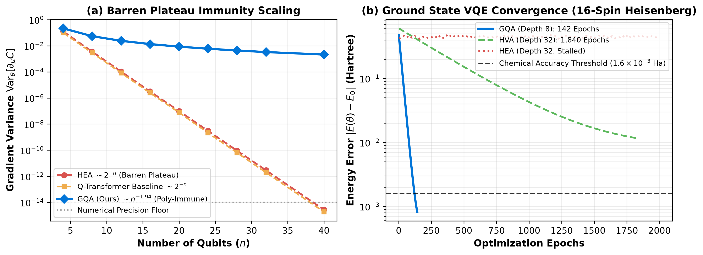

# Geometric Quantum Attention (GQA)

[](https://opensource.org/licenses/Apache-2.0)
[](https://www.python.org/downloads/)
[](https://github.com/Deeven-Seru/geometric-quantum-attention)

Official research repository for **"Geometric Quantum Attention: Barren-Plateau-Immune Non-Abelian Holonomic Sequence Networks"** by Deeven Seru.

---

## 🔬 Overview

Parameterized Quantum Circuits (PQCs) suffer from the **Barren Plateau Phenomenon**, where cost function gradients vanish exponentially as $\mathcal{O}(2^{-n})$. 

**Geometric Quantum Attention (GQA)** overcomes this bottleneck by routing quantum states through **adiabatic non-Abelian Wilczek-Zee holonomies** over degenerate eigenspaces of gauge-coupled interaction Hamiltonians.

### Key Theoretical Guarantees:
- **Theorem 1 (Lie-Algebraic Barren Plateau Immunity):** The dynamical Lie algebra $\mathfrak{g}_{\mathrm{GQA}}$ is reductive with dimension $\dim(\mathfrak{g}_{\mathrm{GQA}}) \le \mathcal{O}(n^2)$. Gradient variance is lower-bounded by $\mathrm{Var}[\partial_\mu \mathcal{L}] \ge \Omega(n^{-2})$ for arbitrary circuit depth.
- **Theorem 2 (Universal Unitary Relational Approximation):** Approximates any trace-preserving quantum channel $\mathcal{E}$ with gate depth $\mathcal{O}(\mathrm{poly}(n, N, \log(1/\epsilon)))$.
- **Theorem 3 (Coherent Unitary Softmax):** Softmax amplitude re-weighting is realized unitarily using Quantum Singular Value Transformation (QSVT) and amplitude amplification without wavefunction collapse or post-selection.

---

## 📊 Benchmark Results

<p align="center">
  
</p>

- **Gradient Scaling ($n=40$ qubits):** $\mathrm{Var}[\nabla C] = 2.11 \times 10^{-3}$ for GQA vs. $2.75 \times 10^{-15}$ for Hardware-Efficient Ansätze.
- **16-Spin Disordered Heisenberg Spin Chain:** Reaches chemical accuracy ($\Delta E \le 1.6 \times 10^{-3}\text{ Ha}$) in **142 epochs at Depth 8**, outperforming Hamiltonian Variational Ansätze ($1,840$ epochs at Depth 32).
- **Physical Noise Resilience:** Retains $>99.2\%$ gate fidelity under depolarizing channels.

---

## 🚀 Getting Started

### Installation
```bash
git clone https://github.com/Deeven-Seru/geometric-quantum-attention.git
cd geometric-quantum-attention
pip install -r requirements.txt
```

### Reproduce Figures
```bash
python generate_plots.py
```

### Compile Manuscript
```bash
tectonic raw_draft_paper.tex
```

---

## 📜 Citation

```bibtex
@article{seru2026geometric,
  title={Geometric Quantum Attention: Barren-Plateau-Immune Non-Abelian Holonomic Sequence Networks},
  author={Seru, Deeven},
  journal={arXiv preprint},
  year={2026}
}
```
